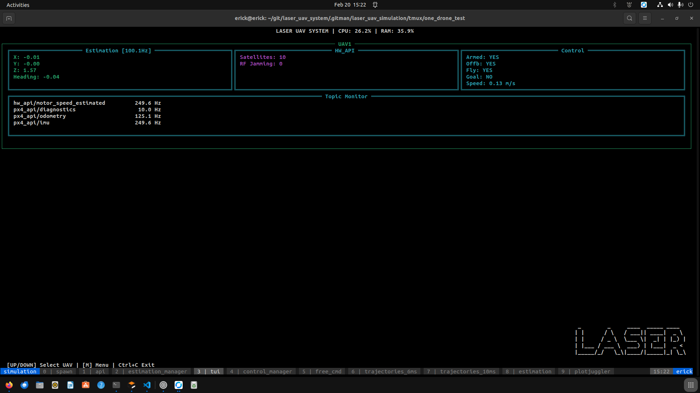
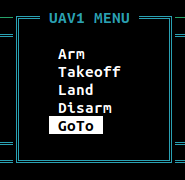
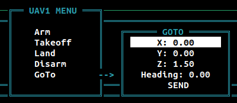

# LASER UAV TUI

`laser_uav_tui` is the terminal dashboard for the LASER UAV System (LUS). It shows vehicle pose, velocity, topic rates and diagnostics, and lets an operator send flight commands without leaving the terminal.

The dashboard discovers up to three UAVs from topics matching `/<uavN>/estimation_manager/estimation`. It also shows host CPU and memory usage.

This package is marked as deprecated in the existing project documentation. The command and interfaces below match the implementation in this repository.



## Run

After building and sourcing the workspace:

```bash
ros2 run laser_uav_tui tui --config $(ros2 pkg prefix --share laser_uav_tui)/config/config.yaml
```

The executable is `tui`. `--config` is optional and selects extra topics to monitor. UAV telemetry and command interfaces use the paths below independently of that file.

### Keyboard controls

| Key | Action |
| --- | --- |
| Up / Down | Select a UAV or menu item. |
| `M` / `m` | Open the action menu for the selected UAV. |
| Enter | Select an action, edit a coordinate or send the goal. |
| Escape | Close a menu or cancel coordinate entry. |
| Ctrl+C | Exit. |

The action menu provides Arm, Takeoff, Land, Disarm and GoTo. In GoTo, select World or Relative mode and enter position in metres and heading in radians. The managers and hardware API decide whether a command can be accepted in the current flight state.





## Interfaces

For a vehicle named `uav1`:

| Direction | Topic or service | Type | Purpose |
| --- | --- | --- | --- |
| Input | `/uav1/estimation_manager/estimation` | `nav_msgs/msg/Odometry` | Pose, velocity and telemetry rate. |
| Input | `/uav1/control_manager/diagnostics` | `laser_msgs/msg/UavControlDiagnostics` | Flight and control information. |
| Input | `/uav1/estimation_manager/diagnostics` | `laser_msgs/msg/EstimationManagerDiagnostics` | Estimator and source status. |
| Input | `/uav1/hw_api/diagnostics` | `laser_msgs/msg/ApiPx4Diagnostics` | Armed/offboard state, preflight status and GPS diagnostics. |
| Input | `/uav1/ov_msckf/num_points_slam` | `std_msgs/msg/Float64` | OpenVINS feature count. |
| Output | `/uav1/planning_manager/goto` | `laser_msgs/msg/PoseWithHeading` | Absolute navigation goal. |
| Output | `/uav1/planning_manager/goto_relative` | `laser_msgs/msg/PoseWithHeading` | Relative navigation goal. |
| Service client | `/uav1/hw_api/arm`, `/uav1/hw_api/disarm` | `std_srvs/srv/Trigger` | Arm/disarm requests. |
| Service client | `/uav1/control_manager/takeoff`, `/uav1/control_manager/land` | `std_srvs/srv/Trigger` | Local takeoff/landing requests. |

The TUI does not run the flight controllers or planners. Those nodes must already be available on the same ROS network.

## Configuration

The [config/config.yaml](config/config.yaml) file has one setting, `topics`, containing the absolute names of extra topics whose publication rates should be displayed:

```yaml
topics:
  - "/uav1/camera/image_raw"
  - "/uav1/lidar/scan"
  - "/uav2/hw_api/odometry"
```

The TUI resolves message types from the ROS graph and assigns each topic to a UAV by namespace. Update the supplied list for your setup; it still includes older `/px4_api/...` paths. Adding a topic here monitors its rate and does not change the telemetry subscriptions or command destinations.
